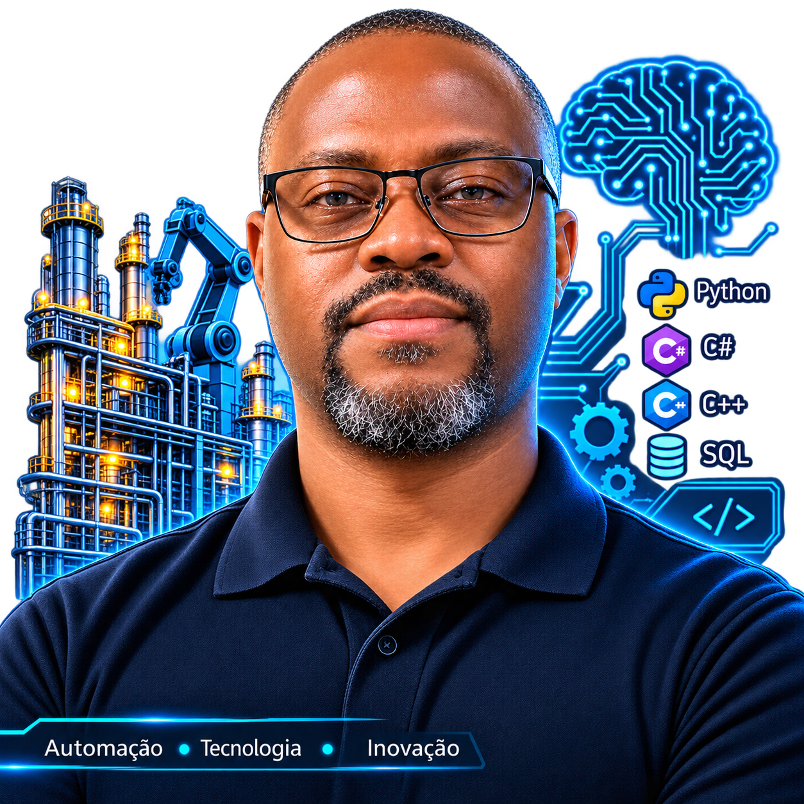

 

# Olá, seja bem-vindo! 👋

---

## Sobre mim

Sou **Engenheiro de Controle e Automação**, com formação técnica em Mecatrônica e experiência profissional em automação industrial, manutenção elétrica e mecânica, instrumentação e sistemas de controle.

Minha trajetória profissional está ligada à resolução de problemas industriais, análise de falhas, sistemas de automação e desenvolvimento de soluções técnicas.

Tenho interesse em ampliar a integração entre engenharia, tecnologia e desenvolvimento de software, explorando áreas como inteligência artificial, ciência de dados e processamento de imagens.

Acredito na aplicação prática da tecnologia para resolver problemas reais.

## Áreas de atuação e interesse

- Automação industrial e sistemas de controle.
- PLCs, IHMs e sistemas supervisórios.
- Instrumentação industrial e análise de falhas.
- Desenvolvimento de software e integração de sistemas.
- Python, processamento de dados e visão computacional.
- Inteligência artificial e ciência de dados.

## Tecnologias e ferramentas

## Em aprendizado e desenvolvimento

## GitHub Statistics

  

## Contribution Activity

<picture>
  <source media="(prefers-color-scheme: dark)" srcset="https://raw.githubusercontent.com/Alanderson-Paula/Alanderson-Paula/output/github-contribution-grid-snake-dark.svg">
  <source media="(prefers-color-scheme: light)" srcset="https://raw.githubusercontent.com/Alanderson-Paula/Alanderson-Paula/output/github-contribution-grid-snake.svg">
  
</picture>

---

**Engenharia | Automação | Tecnologia | Desenvolvimento | Inovação**

